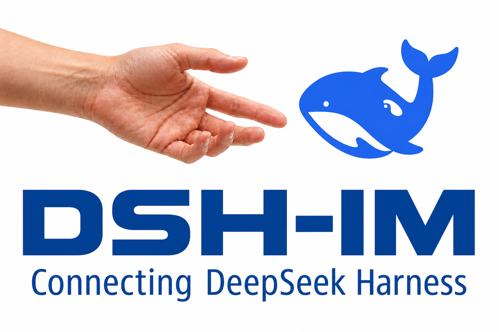
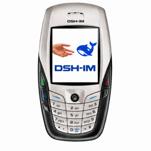
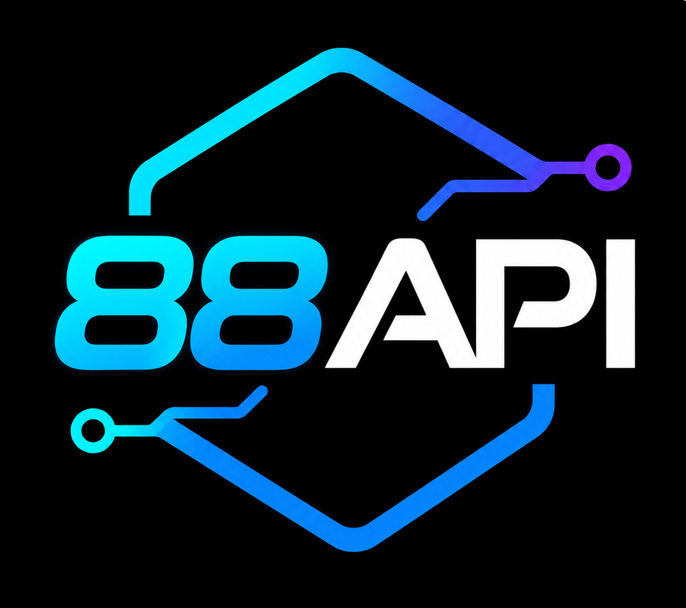
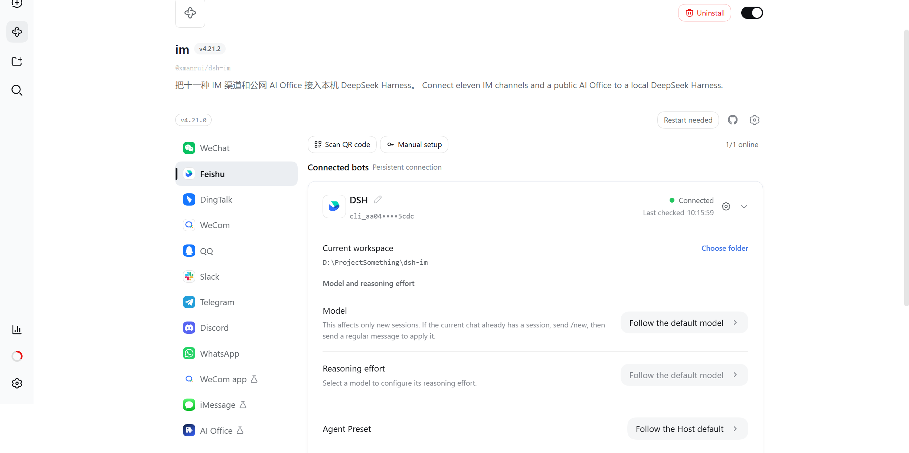
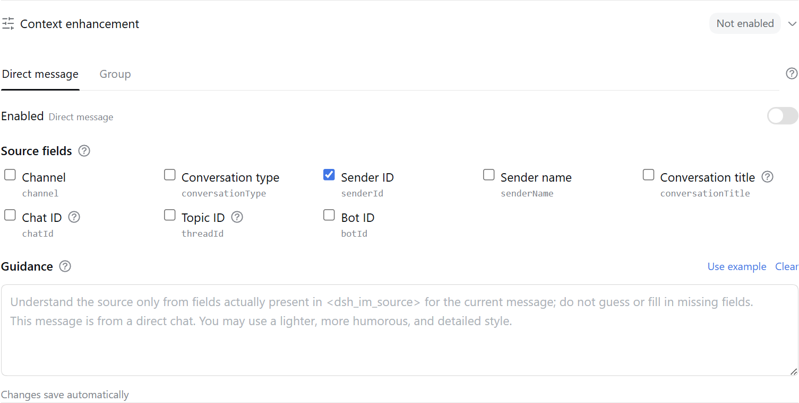
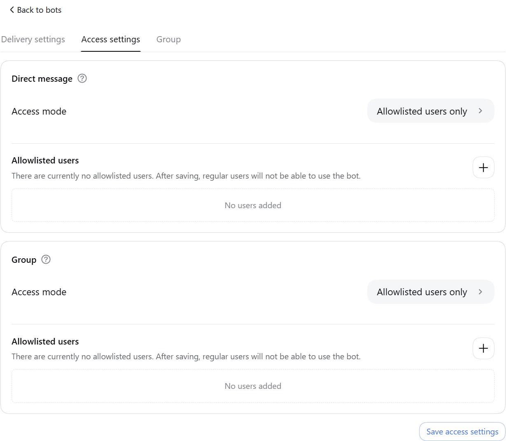

<p align="center">
  &nbsp;&nbsp;
  
</p>

---

<div align="center">
  <p><strong>Connecting DeepSeek Harness</strong></p>

  <p>
    
    <a href="LICENSE"></a>
    <a href="#recognition"></a>
    <a href="https://deepseek1024.com/"></a>
    <a href="https://dshfind.com/zh/plugins/xmanrui/dsh-im"></a>
    <a href="https://dshfind.com/zh/plugins/xmanrui/dsh-im?ref=badge"></a>
  </p>

  <p>
    
    
    
    
    
    
    
    
    
    
  </p>

  <p>
    <a href="https://trendshift.io/repositories/169119#achievements">
      
    </a>&nbsp;
    <a href="https://trendshift.io/repositories/169119#achievements">
      
    </a>
  </p>

  <p><a href="README.md">简体中文</a> · <strong>English</strong></p>
</div>

---

## ❤️ Sponsors

<table width="100%">
  <tr>
    <td width="180" align="center" valign="middle">
      <a href="https://88api.ai/sign-up?aff=lJoL"></a>
    </td>
    <td valign="middle">
      <a href="https://88api.ai/sign-up?aff=lJoL"><strong>88API Token Aggregation Platform</strong></a> sponsors this project! Operated by a Hong Kong company, 88API is an all-in-one, multi-model API platform for developers, creators, and AI application users. Its unified interface connects text, image, speech, and video models for workflows including AI coding, translation, content creation, voiceovers, image generation, and video generation. It offers high-quality, discounted access to official DeepSeek inference services and self-hosted DeepSeek inference on its own B300 clusters. It supports major international payment methods, provides invoices, and offers enterprise-grade reliable service. <a href="https://88api.ai/sign-up?aff=lJoL"><strong>Sign up through this link to receive exclusive bonus credits!</strong></a>
    </td>
  </tr>
  <tr>
    <td width="180" align="center" valign="middle">
      <a id="recognition"></a>
      <a href="https://github.com/deepseek-ai/deepseek-harness"><strong>DeepSeek<br>Harness</strong></a>
    </td>
    <td valign="middle">
      <strong>DSH-IM has received official sponsorship from <a href="https://github.com/deepseek-ai/deepseek-harness">DeepSeek Harness</a> in the form of token credits</strong>. Thank you to the DeepSeek Harness team for supporting this project!
      <p>This project is independently developed and maintained by community developers.</p>
    </td>
  </tr>
</table>

---

> [!IMPORTANT]
> **Install using the full package name: `@xmanrui/dsh-im`**
>
> To avoid name confusion, copy the full package name below when searching the plugin marketplace, entering it in the plugin installer, or installing from the command line.
>
> ```text
> @xmanrui/dsh-im
> ```
>
> Choose one command: use **Desktop**'s built-in terminal or the terminal used to start the current Harness for **Web**.
>
> ```sh
> dsh plugin --profile desktop add -w @xmanrui/dsh-im
> ```
>
> ```sh
> dsh plugin --profile web add -w @xmanrui/dsh-im
> ```
>
> Restart Desktop or `dsh web`, refresh the browser for Web, then open **Settings → IM Bot**.

## Introduction

Connect IM bots to DeepSeek Harness by scanning a QR code, using an App Manifest, or entering existing bot credentials, and let the local Harness connect outward to a public AI Office. One plugin and one settings entry manage the built-in IM channels and the AI Office Connector. iMessage uses one native Messages.app identity per macOS user account; see the [iMessage channel notes](docs/imessage.md).

## Interface



 

## Built-in channels

| Channel | Setup | Messaging and replies |
| --- | --- | --- |
| Feishu | Create a bot by QR code, or bind one with App ID + App Secret | Persistent connection for incoming messages; choose a native live process, one live process card, or step-by-step messages; each bot can enable voice interaction (optional channel capability, off by default): voice messages are transcribed into the normal text pipeline, and the answer is also sent as a voice reply |
| WeChat | Scan a QR code to bind a WeChat bot | Tencent iLink long polling; shows a typing indicator while Harness works, then sends the final reply in 1,800-character chunks |
| DingTalk | Create a bot by QR code, or bind one with Client ID + Client Secret | DingTalk Stream connection; streaming replies through AI Cards |
| WeCom | Create an intelligent bot by QR code, or bind one with Bot ID + Secret | Official WebSocket connection; native thinking state, tool progress, and streaming replies |
| QQ | Create a bot with mobile QQ QR scanning, or bind one with AppID + AppSecret | WebSocket connection; private chats show typing and receive one Markdown reply, while mentioned group chats receive only the final answer |
| Slack | Create an app from the bundled App Manifest, then enter a Bot Token (`xoxb-`) and App Token (`xapp-`) | Socket Mode connection; direct DM replies, mention-only channel replies, and preferred native streaming API |
| Telegram | Enter a Bot Token generated by @BotFather | Bot API long polling; DMs work by default and groups respond to mentions or replies, while each bot can optionally enable a private-DM allowlist; with thinking traces off, private chats, groups, and Topics edit a placeholder for progress and finalize rich replies in place, avoiding Drafts that block the Android private-chat composer; unsupported Rich delivery falls back to ordinary text |
| Discord | Enter a Bot Token generated in the Developer Portal | Gateway v10 connection; direct DM replies; the first mention in a server text or announcement channel creates a native Thread, where follow-up messages no longer need to mention the bot; replies stream through message edits |
| WhatsApp | Scan a QR code with mobile WhatsApp to link a device | WhatsApp Web connection; self-chat only by default, with optional selected-contact and open-response modes; groups require a mention or a reply to a bot message, including for the linked account; read receipt and typing indicator, with tool progress and incremental answers shown by editing one message at one-second intervals; long replies split automatically and failed edits fall back to a complete text reply |
| iMessage | Sign in to iMessage in macOS Messages.app and grant the local permissions described in the [channel notes](docs/imessage.md) | Native macOS Messages.app transport for text DMs; no BlueBubbles or third-party gateway; one local iMessage identity per macOS user account |
| Matrix (experimental) | Enter the homeserver URL plus an access token, or a user id with a password | CS API long polling; DMs are answered directly and rooms answer when the bot is @-mentioned, with thread replies, allowlisted HTML, edit-based streaming, and image/result-file delivery; includes experimental room-message encryption/decryption, subject to the limits below |

WhatsApp retains the identifiers of the latest 2,000 bot messages sent to groups, so replies to those messages still work after a restart. Replies to older messages outside that history, including unrecorded messages sent before upgrading, do not wake the bot; mention the bot or reply to one of its new messages instead.

Matrix encryption is currently for non-sensitive testing only. The default optional mode attempts to start the crypto engine and skips incoming encrypted messages if it fails; required mode refuses to connect when crypto startup fails. Interactive device verification, key backup, SSSS, and attachment-content encryption are not implemented. This release has not been validated against a live homeserver/Element setup; do not treat it as a complete end-to-end confidentiality guarantee.

Other IM platforms can be added through the same channel-adapter structure.

The channel capability matrix below is generated from `src/channels/*/` by
`scripts/channel-capability-matrix.mjs`; `npm run check` fails when it drifts from the source.

<!-- channel-capability-matrix:start -->
> This table is generated from `src/channels/*/` by `scripts/channel-capability-matrix.mjs`;
> it is not hand-written: run `node scripts/channel-capability-matrix.mjs` to reproduce it.
> ✅ = the channel directory contains an implementation for this capability;
> — = no implementation found, i.e. an explicit degradation (ADR-0001).

| Channel | Text | Image | File | Voice | Quote | Group | Stream | Card | Rich text |
| --- | --- | --- | --- | --- | --- | --- | --- | --- | --- |
| `dingtalk` | ✅ | ✅ | ✅ | — | — | ✅ | — | — | ✅ |
| `discord` | ✅ | — | ✅ | — | ✅ | — | ✅ | — | — |
| `email` | ✅ | ✅ | ✅ | — | — | — | — | — | — |
| `feishu` | ✅ | ✅ | ✅ | ✅ | ✅ | ✅ | ✅ | ✅ | — |
| `imessage` | ✅ | — | — | — | — | — | — | — | — |
| `matrix` | ✅ | ✅ | — | — | — | ✅ | — | — | ✅ |
| `office` | — | — | — | — | — | — | — | — | — |
| `qq` | ✅ | ✅ | ✅ | — | — | ✅ | — | — | — |
| `slack` | ✅ | — | ✅ | — | — | ✅ | ✅ | — | — |
| `telegram` | ✅ | ✅ | ✅ | ✅ | ✅ | ✅ | ✅ | ✅ | — |
| `wecom` | ✅ | ✅ | — | — | ✅ | ✅ | — | — | — |
| `wecom-app` | ✅ | ✅ | — | — | — | ✅ | — | — | — |
| `weixin` | ✅ | ✅ | ✅ | — | — | ✅ | — | — | — |
| `whatsapp` | ✅ | ✅ | ✅ | — | — | — | — | — | ✅ |
<!-- channel-capability-matrix:end -->
The iMessage contribution is documented separately in [the iMessage channel
notes](docs/imessage.md); it uses the native macOS Messages.app and requires no
third-party gateway.

New Feishu and QQ bots connected through the QR flow allow all users to chat and execute built-in commands in both direct and group chats by default. Allowlists and command permissions remain configurable in each bot's access settings. Existing bots keep their saved access settings.

Feishu group chats accept messages from other bots that explicitly mention the current bot by default, with no extra setting. Messages without that mention, mentions of only other members or everyone, self-sent messages, and bot DMs are still ignored, even in all-message mode. Group allowlists and command permissions still apply. The app needs the `im:message.group_at_msg.include_bot:readonly` tenant scope. New apps request it through the QR flow; existing or manually connected apps can use **Complete permissions** or `/repair` in a direct chat, scan the QR code, and complete any publication or approval required by Feishu. See the [Feishu message-event permissions](https://open.feishu.cn/document/server-docs/im-v1/message/events/receive).

Built-in channels with image input support can send JPEG, PNG, and WebP images, plus GIFs sent as image files, with optional captions to Harness. By default, original images can be up to 30 MB each, with up to 20 images per message. Originals are saved in the Session workspace; model copies are resized or compressed to 5 MB each and 20 MB total. Images that still exceed the budget, or are rejected by a non-vision model, are delivered as workspace files. These four limits can be changed under General settings → Attachments → Image input for subsequent messages. Originals follow attachment retention settings. Higher model limits increase request size, latency and model cost, and remain subject to platform and Host limits. iMessage's MVP supports text DMs only. Downloading images or files from Feishu user messages requires the `im:message:readonly` tenant scope, shown on the confirmation page as **Read direct and group messages**; Feishu currently offers no narrower image-only scope for that download endpoint. Apps created through the built-in QR flow request it by default; for existing or manually connected apps, click **Complete permissions** on the IM Bot settings page and scan the QR code to incrementally add that scope, `im:resource` for uploading bot-sent images or files, `application:app_slash_command:read` / `write` for the native command panel, and the card callback.

### Shared group messages and files

WhatsApp, Feishu, Telegram, Discord, Slack, and QQ can automatically save received group messages and attachments, including messages without mentions when the platform permits delivery. Recording is enabled by default and does not itself trigger a model reply. Mention a bot in the group to search records, summarize discussions, or read files on demand.

Records are shared by group, independently of bots, AI Sessions, and workspaces. Retention defaults to a rolling **14 days**, configurable under **DSH Settings → IM Bots → gear icon, General settings → General**. Only received content is saved; full history is not backfilled. QQ archives are currently isolated by app, and Discord threads have separate archives.

See the [group history and shared files guide](docs/group-history.en.md) for all six platforms' permissions and setup steps, query examples, storage, file limits, and troubleshooting. Live tests passed for text and text-file attachments on WhatsApp, Feishu, and QQ. Telegram text passed, with files still untested; Discord and Slack await live group verification.

### Results after a reply timeout

Connected IM channels share deferred task tracking. After a model reply timeout, the plugin keeps checking the original task and delivers its final text to the original chat or thread. Checks resume after a plugin restart or reconnection. `/stop` only stops the matching turn submitted by that chat; changing the bound Session prevents old results from being delivered there. No new setting is required, and normal replies keep their existing flow.

Channel permissions and quotas still apply. Definite send failures allow up to three attempts; uncertain delivery is retained without automatic retries to avoid duplicate messages. Recovery covers final text and terminal notices, without replaying questions, approvals, or file-tool calls. See the [deferred delivery notes](docs/deferred-delivery.md).

### Result-file and image delivery

Built-in channels with file delivery support can return any file readable by Harness as a native channel attachment. Existing files and files created by the current task can both be sent directly. The capability is available to every connected bot by default, with no switch or per-bot allowlist, while existing text, image, streaming, command, and Session behavior remains unchanged. iMessage's MVP does not support files or attachments.

After the model calls the file-return tool, the plugin hands the specified file to the channel's native API. Images prefer native image messages; if a channel does not support or definitively rejects image delivery, the plugin falls back to a file attachment, while an uncertain result never triggers a duplicate fallback. The plugin adds no rules for file origin, creation time, workspace boundary, extension, content, count, size, or lifetime; the file only needs to exist and be readable. A channel may still reject delivery according to its own permissions, quota, file capability, or account tier, and the plugin reports that provider result.

| Channel | Platform requirements |
| --- | --- |
| WeChat | The current binding protocol and conversation must support native file messages; the WeChat API response determines the actual range. |
| Feishu | Feishu's file-upload API requires a non-empty file no larger than the platform's 30 MB limit. The app needs the `im:resource` tenant scope (**Read and upload images or other files**). Apps created through the built-in QR flow request it by default; existing or manually connected apps can add it incrementally through **Complete permissions** or `/repair` in a direct chat, followed by any approval Feishu requires. The Feishu developer console currently has no separate `im:resource:upload` scope. |
| DingTalk | The app needs `qyapi_base`, and the bot must support file messages. The current OAPI and bot capability determine the accepted formats and sizes. |
| WeCom | The app needs media-upload and file-message capability; the WeCom API response determines the actual range. |
| QQ | The bot needs file-message capability and remains subject to QQ's daily upload quota; the bot reports when the quota is exhausted. |
| Slack | The Bot Token needs `files:read`, `files:write`, and `reactions:write`; the Workspace's current policy determines the actual file-size limit. After changing scopes, re-authorize/reinstall the App and reconnect the bot. |
| Telegram | The bot must be allowed to send documents in the current chat; the Bot API response determines the actual range. |
| Discord | Enable **Message Content Intent** in the Developer Portal. The bot needs **Send Messages**, **Create Public Threads**, **Send Messages in Threads**, and **Read Message History**; result-file delivery also requires **Attach Files**. The current account and server capability determine the actual attachment allowance. |
| WhatsApp | The linked session must support Document Messages; the WhatsApp/Baileys response determines the actual range. |
| Matrix | The homeserver must allow media uploads; its media repository configuration decides the real per-file limit. When an upload is rejected, the plugin asks you to check the media size limit and upload permissions. |

## AI Office Connector

[Read the AI Office Connector guide](docs/AI-Office-Connector.en.md)

## Installation

Install the published stable release of **`@xmanrui/dsh-im`** from npm (recommended). Choose the command for the application you use:

**DSH Desktop**: run in the current Desktop application's built-in terminal:

```sh
dsh plugin --profile desktop add -w @xmanrui/dsh-im
```

Restart DSH Desktop after installation.

**DSH Web**: run in the terminal environment used to start the current Harness:

```sh
dsh plugin --profile web add -w @xmanrui/dsh-im
```

Restart `dsh web` and refresh the browser after installation.

After restarting, open **Settings → IM Bot**. The top-level IM Bot entry uses `order: 21` to follow **Agent Presets**, and the Plugins page no longer retains the old entry. Upgrading preserves existing bots, credentials, workspaces, Agent Presets, and Session bindings.

Local `dsh web` and DSH Desktop reuse the current Host's internal services by default: the Typert Gateway invokes the Session and Workspace controllers. No Harness address or loopback HTTP connection is required. Desktop's compatibility, extended-window, and advanced modes do not require browser access or LAN access to be enabled. An explicit channel `harnessBaseUrl` is retained only for legacy remote HTTP/WebSocket Harness endpoints; failed internal calls never silently switch to another Host.

To try the latest code before it is published to npm, use the GitHub-source installer instead:

```sh
npx -y github:xmanrui/dsh-im install
```

A GitHub-source installation fetches and builds a Git dependency directly. With pnpm 10 or newer, the profile may first need an `allowBuilds` entry in `pnpm-workspace.yaml`. Most users should prefer the stable npm release.

After installation, follow the built-in instructions on each channel page to scan a QR code or enter credentials. Secrets and Tokens are sent only to the local Harness Host and stored through its protected credential provider; status responses and bot lists never return them.

If this machine must use a forward proxy to reach Feishu, set `HTTPS_PROXY` to a full HTTP proxy URL before starting `dsh web` (for example, `http://proxy:8080`; lowercase `https_proxy` is also supported, with `HTTP_PROXY` accepted as a fallback), then restart the Host after changing it. Feishu registration and credential verification reuse the SDK's proxy-aware HTTP client, while the message WebSocket explicitly uses that proxy; the WebSocket path does not currently read `ALL_PROXY` or `NO_PROXY`.

If this machine cannot reach the Telegram Bot API directly, use Node.js 22.21 or newer and enable Node's environment proxy support before starting `dsh web`:

```sh
NODE_USE_ENV_PROXY=1 \
HTTPS_PROXY=http://proxy:8080 \
HTTP_PROXY=http://proxy:8080 \
NO_PROXY=localhost,127.0.0.1 \
dsh web
```

Use the proxy URL required by your network and restart the Host after changing it. If Telegram Bot Token binding reports that the Bot API cannot be reached, first check the proxy URL, Node.js version, and `NO_PROXY` configuration.

| Default behavior | Description |
| --- | --- |
| Bot alias | Click the pencil beside a bot name to set an alias. Saving updates the display immediately, without restarting or reconnecting. The original name is retained; choose “Restore original name” or save an empty alias to restore it. Aliases only affect names shown in the local settings page. |
| Bot workspace | Each bot stores its workspace independently. New bots use `$DSH_HOME/im` (`~/.dsh/im` when unset); the directory is created when a bot or conversation selects it. Starting the plugin does not create it when all bots and conversations use other workspaces. New sessions appear under Ungrouped. Change it later from the bot card. An explicit `workspace` takes precedence, and `dshHome` overrides the `DSH_HOME` environment variable. |
| Model | Every bot in each IM channel can choose a model directly below its workspace, or follow the Host default. A change applies only to later new Sessions; send `/new` and then an ordinary message in the current chat to use it. |
| Reasoning effort | Explicitly choose an effort supported by the selected model, or follow the model default. Levels, descriptions, and defaults come from DSH. Switching models restores the new model's default effort. Each bot saves its own choice, which applies only to later new Sessions. |
| Agent Preset | Each bot can choose an Agent Preset on its settings card. When none is chosen, new Sessions follow the Host's `agent-presets.default`. A channel-level `config.agentPreset` is only the default for later new bots on that channel. Changing the preset never modifies or clears existing Sessions; if the current chat already has a Session, send `/new` and then a regular message to create one with the new selection. |
| Context enhancement | Open settings from a bot card to enable groups and DMs independently. Both switches default to off, including for existing bots after an upgrade. |
| Feishu command panel | Each Feishu bot decides, under **More settings → Command panel**, which commands the "/" list in the chat input offers and in what order. *Follow the default* keeps the shipped 34-command manifest (updated with the plugin); *custom* is exactly the chosen commands in the chosen order. Hiding a command only removes it from the list — typing it by hand still works — and commands added outside this manifest are never removed. Once one bot is set up, **Save and copy to the other bots** writes the same panel to every other bot on the channel (their own panel settings are overwritten; offline bots pick it up when they start). The bot syncs the panel in the background after saving, so a change takes a moment with many commands. |
| Feishu topic on mention | On by default. Mentioning the bot in a group or a private chat opens a dedicated Feishu topic under that message, and both the question and the answer stay inside it. The topic is an independent conversation in the dsh session list, and later messages in the topic belong to the same conversation. A bare "@bot" (which opens the menu) opens no topic, and messages without a mention stay in the chat's own conversation. Turn it off from the bot card's "Group" settings to return to flat replies in groups and private chats alike. |
| Feishu task progress display | Each Feishu bot can hide progress or use Live process, Live process card, or step-by-step messages. Live process uses Feishu's native thinking-process surface for reasoning, tool calls, and results, then sends the final answer separately. It requires Feishu desktop 7.70, mobile 7.74, or newer. Feishu's native thinking process currently cannot be posted inside a topic, so turns in a topic use the Live process card instead and keep the process and the answer in the topic. |
| Feishu voice interaction | Configure each Feishu bot independently under **More settings → Voice** on its bot card (optional channel capability, off by default). When enabled, voice messages are transcoded with ffmpeg and transcribed by DashScope `qwen3-asr-flash`, then processed through the normal text pipeline (commands, Sessions, model calls, and file delivery behave identically); the same turn's answer is also synthesized with `qwen3-tts-flash` as a voice reply to the original message. If transcription fails, the bot falls back explicitly to the existing text/image/file-only notice. The DashScope key is managed in the plugin credential store by environment variable name (`secretRef`, default `DASHSCOPE_API_KEY`) and never enters bot configuration. The ASR model, TTS model, reply voice (official `qwen3-tts-flash` voices such as Cherry, Serena, Bella, Chelsie, Momo, Katerina), and ffmpeg path are per-bot settings. It requires a working local ffmpeg and a key that can reach DashScope. |
| Session channel identity | Sessions from the local Host's IM channels and AI Office are marked with their source. The Web Session list and search results display channel logos in place of prefixes such as “WeChat ·”, preserving DSH's automatic title generation and updates. Existing Sessions receive the prefix when next loaded. |

Channel prefixes are appended after DSH produces a title, preserving its complete text and automatic/manual source without pinning automatic titles or making additional model calls. Regeneration, refresh, and restarts do not stack prefixes; actual manual renames retain DSH's normal pinning behavior. This feature uses the current Host's Session events; an explicit remote `harnessBaseUrl` requires the plugin on the destination Host.

Logos are a dsh-im browser enhancement and require no changes to DSH. The adapter preserves original text nodes, clicks, menus, and dragging; copied titles, screen readers, and other surfaces retain the textual channel name. Unrecognized DSH page structures, unsupported browsers, or image-loading failures keep the text prefix. Unloading the plugin restores the original display.

### Queueing and steering

Open a bot's **More settings → General**, choose **New messages while a task is running**, and save. Each bot has its own setting, across all 13 chat channels.

- **Queue (default)**: process new messages after the current task finishes, with a queue receipt when they need to wait.
- **Steer**: add ordinary plain text to the current task for the Agent to read at its next step, with a submission receipt. There is no need to type `/steer` each time.

When idle, messages start a task normally. Images, files, voice messages, and quoted replies keep their existing handling. Group mention rules and permissions still apply; automatic steering requires `/steer` permission. Both modes retain `/steer <additional instruction>` for manual steering.

Saving takes effect for newly received messages immediately; already queued messages stay queued. AI Office has no ordinary chat follow-up input, so this setting does not apply to it.

### Proactive delivery

IM channels with proactive delivery support can send text through a stable `botId + targetId` pair. Bot settings support choosing a known conversation or entering a target manually, testing the current route before saving, and copying call parameters. HTTP POST, same-Host plugins, and Connection RPC share the same target configuration and delivery core.

Saved direct-message targets also offer an opt-in **Two-way Session sync** switch. Once enabled, user text submitted from DSH Web/CLI and the final assistant text in that DM's current Session are mirrored back to the DM, including final assistant text from successfully completed scheduled tasks; ordinary IM prompts and `/steer` are not duplicated. The switch follows the current Session across `/session`, `/new`, and workspace changes. The first version supports text DMs on the current Host only; groups, Topics, Threads, and explicit remote `harnessBaseUrl` connections are unavailable.

Synced answers use channel-specific Markdown rendering: Feishu cards, Telegram rich text, QQ/DingTalk/Slack formatted messages, and existing WeCom bot, Matrix and Discord support. WhatsApp adapts common formatting; WeCom app and Weixin preserve the full text. Formatting fallback and long-message handling reuse channel mechanisms without adding retries for uncertain delivery.

See the [Proactive Delivery Guide](PROACTIVE_DELIVERY.en.md) ([简体中文](PROACTIVE_DELIVERY.md)) for setup steps, native fields for each supported channel, complete call examples, management endpoints, error codes, and troubleshooting.

### Client panel integration

DSH versions supporting global panels show **IM bots** in the left sidebar, using a thin monochrome outline of the catalog's linked speech bubbles to open the full management panel. Settings → IM bots and the plugin detail page's Open IM bots action remain available. Shells can also embed the panel through the optional `dshImClient` service. See the [client integration guide](docs/client-integration.md) for the contract, compatibility requirements and lifecycle example.

### Context enhancement

[Read the context enhancement guide](docs/context-enhancement.md)

### Access modes

[Read the access modes guide](docs/access-modes.md)

## Checking and installing updates

[Read the update-checking and installation guide](docs/checking-and-installing-updates.md)

## Bot commands

| Command | Description |
| --- | --- |
| `/help` | Show the commands and usage supported by the bot. |
| `/menu`, `/m` | Open the Feishu, DingTalk or Enterprise WeChat interactive menu. DingTalk arranges session, workspace, preset and model dropdowns in two columns; selections apply immediately and update the same card. WeCom requires Apply after selecting; open its menu explicitly with `/m` or `/menu`. Entering a direct chat does not open it automatically. Action buttons return their result without sending the menu again. Menus include new session, stop, compact, clear context, status and help buttons. |
| QQ `/menu`, `/m` | Open a button and numbered menu for session selection, workspace, mode/preset, model, new session, session list, stop, compact, steering, archived-session visibility, status and help. Lists support pagination; reply with a number when buttons are unavailable. Menus are scoped to the chat and actor and expire after 15 minutes or restart. Ordinary messages exit number selection; questions, approvals and batch input retain priority. |
| `/new` | Unbind the current chat so its next ordinary message starts a new Harness Session. |
| `/status` | Check the connection between the current bot and DeepSeek Harness. |
| `/version` | Show the version of the running dsh-im plugin. |
| `/models` | List every currently configured model with a number. |
| `/model` | Show the model and reasoning effort used by the Session bound to this chat. |
| `/model <number or provider/model-id> [reasoning effort ID]` | Switch the Session model and optionally select an effort supported by the target model. |
| `/reasoninglist`, `/reasonings` | Equivalent aliases that list the reasoning efforts supported by the current model. |
| `/reasoning` | Show the current Session model and reasoning effort. |
| `/reasoning <number or effort ID>` | Switch the current model's reasoning effort. |
| `/reasoning --default` | Restore the current model's default reasoning effort. |
| `/presetlist`, `/presets` | Equivalent aliases that list the Host's currently available Agent Presets, marking the Host default and this bot's selection. |
| `/preset` | Show this bot's Agent Preset setting for new Sessions. |
| `/preset <number or Preset ID>` | Set this bot's Agent Preset; use `/preset id:<ID>` for a numeric ID. |
| `/preset --default` | Clear this bot's explicit selection so later new Sessions follow the Host default. |
| `/permissionlist` | Feishu and QQ: list numbered permission presets for the bound session. |
| `/permission [number or full ID]` | Feishu and QQ: show or immediately switch the current session permissions; numeric IDs use `/permission id:<ID>`. |
| `/stop` | Immediately stop this chat's running task while preserving work that has not started. |
| `/steer <additional instruction>` | Inject an additional instruction into this chat's running task. |
| `/batch` | Start batch input in a direct chat and collect up to 10 text messages. |
| `/send` | Submit the collected messages, in order, as one input. |
| `/cancel` | Cancel batch input and discard its collected messages. |
| `/repair` | In a Feishu direct chat, incrementally repair the card callback and permissions required for media, group bot mentions, and the native Slash Command panel. |
| `/compact` | Immediately compact older context in the Session bound to the current chat. |
| `/clear` | Clear the model context in the Session bound to the current chat while retaining its Session binding and history; report explicitly when the current Host does not support the command. |
| `/workspace [workspace index or absolute path]`, `/ws [...]` | View and switch the current bot's Harness workspace: without an argument it lists switchable workspaces (a tappable card on Telegram — one tap switches and the current entry is re-marked in place); an index or absolute path switches directly. |
| `/workspacelist`, `/workspaces`, `/wsl` | Legacy aliases of `/workspace`, equivalent to its no-argument form; native command menus keep a single workspace entry. |
| `/sessionlist [workspace number or absolute path]`, `/sessions [...]` | Equivalent aliases that list session IDs and titles in the selected workspace, including ungrouped sessions in the default IM directory; omit the argument to use the current workspace. |
| `/sessionlist --limit N`, `/sessions --limit N` | List the first N sessions in the current workspace's existing order; N must be a positive integer. |
| `/session <Session ID>` | Bind the current chat to an existing Harness session. |
| `/history [count]` | Preview recent messages from the bound Session in a direct chat; defaults to 3, capped at 5. |
| Interactive question | Reply with an option number, option label, or custom text; separate multiple choices with commas. In Feishu, an image or image post from the person answering ends the pending question turn and is processed in the same Session, without finishing the remaining questions or resending the image. |
| Remote approval | Reply with `批准` / `拒绝` / `同意` / `不同意` / `yes` / `no`. |

Web and bot approvals share one decision: the first allow-once or reject wins and retires the other prompt. Supported channels are WeChat, Feishu, DingTalk, WeCom bot/app, QQ, Telegram, Slack, Discord, WhatsApp, and Matrix; iMessage, email, and AI Office are excluded. Bot-origin approvals use the original chat. Web/Host-origin approvals require exactly one bound private chat with bidirectional sync enabled; aliases of that chat count once, while multiple chats receive a Web-only notice. Binding and access checks apply again when submitting, and permanent approval is not offered. Slack delivery from Web additionally requires `im:read`; update the app Manifest and reinstall the app if needed. Web remains usable when the bot cannot present an approval.

### Command details

[Read the command details](docs/bot-commands.md)

DingTalk menus use a shared template built into the plugin; no template setup is needed for each bot. A menu stays active for 30 minutes. Send `/m` again after expiry or a Host restart. Maintainers can import `assets/dingtalk-menu-template.json` into DingTalk's card platform to maintain the template.

## Other features

- **Image understanding**: built-in channels with image input support can send JPEG, PNG, WebP, and GIF files sent as images to Harness, with an optional text description. Originals are saved in the workspace (default 30 MB per image, 20 images per message). Model copies are resized or compressed within configurable 5 MB per-image and 20 MB total budgets, with workspace-file fallback when necessary. Configure these limits in General settings → Attachments → Image input. iMessage's MVP supports text DMs only.
- **Switch workspaces from a bot card**: every bot card on the settings page shows its current Harness workspace. Enter an existing absolute directory path directly or open the directory picker. Switching clears only that bot's old chat mappings; it never deletes, empties, or archives old Sessions. Replies already in progress may finish, while later messages use the new workspace.
- **Default directory and ungrouped sessions**: bots using the default share `$DSH_HOME/im`, while retaining separate chat-to-Session mappings. The plugin creates no workspace group for this directory. Use `/sessions` to list its ungrouped sessions and `/session <Session ID>` or `/session N` to bind an ordinary session. New sessions in other directories use the existing workspace grouping mechanism; switching back to the default directory creates ungrouped sessions again. Existing bot directories are not migrated automatically.
- **Choose a model and reasoning effort from a bot card**: every bot card in each IM channel offers model and effort controls below the workspace, with DSH-style provider groups, descriptions, and checkmarks. Select an available model and one of its supported efforts, or use the model default. Leaving the model unset follows the Host default. Settings are stored per bot and used only for later new Sessions; existing Sessions and replies already in progress are unchanged.
- **Choose an Agent Preset from a bot card**: every bot card can select one of the Host's existing Agent Presets, or follow the Host default. The change applies only to that bot and only to later new Sessions; existing Sessions and replies already in progress are left unchanged.
- **Check the connection and send a test message**: when a bot is online, clicking **Check connection** verifies the platform connection and sends a “DeepSeek Harness connection test succeeded” message to the bot's most recently remembered direct conversation; WhatsApp uses the account's self-chat. The test neither creates a Harness Session nor invokes the model. The bot must have received at least one direct message before it has a remembered test target; otherwise the page reports that no test conversation is available yet.
- **Retry a connection or remove an integration**: when a bot is offline, its card action changes to **Retry connection**. Use **Remove integration** when the bot is no longer needed. Each action affects only the selected bot and leaves other bots and channels unchanged.
- **Manage multiple bots independently**: a channel can have multiple connected bots. Credentials, connection state, workspace, model, Agent Preset, and chat-to-Session mappings are kept separately for every bot, so card actions do not affect sibling bots.
- **Streaming replies and progress**: the plugin uses each platform's available capabilities to show thinking state, tool progress, and incremental answers. Platforms without a native streaming API complete replies through message edits, card updates, or a final message.

If setup, connection, or removal fails in WeChat, Feishu, DingTalk, Enterprise WeChat, QQ, Slack, Telegram, Discord, WhatsApp, Enterprise WeChat App, iMessage, Email, or AI Office, expand **Diagnostic details** and choose **Copy diagnostics**. Include the steps, Desktop/Web mode, and actual DSH version in your report; use the displayed `WX-CONN-…`, `DT-CONN-…`, or `IM-CONN-…` reference to find the matching channel Host log. Diagnostics preserve the failing stage, recognized underlying causes, HTTP status, and available timings. Multiple causes are listed together; unrecognized causes are explicitly marked **Unknown**. Login tokens, QR contents, and raw responses are excluded. When removal succeeds but local cleanup fails, the page retains a cleanup warning. Message failures keep their existing `MF-…` references. If the page cannot reach the DSH management API and has no Host reference, check the DSH management connection. Investigate network failures on the machine running DSH.

Startup configuration validation failures also include `file`, `field`, and `issue`, identifying the first rejected field in `config.json` or `workspaces.json`. Field positions use zero-based entry order: `workspaces[0].value` means the first workspace entry's value without exposing its account identifier. The default directory is `DSH_HOME/integrations/dsh-weixin`, or `~/.dsh/integrations/dsh-weixin` when `DSH_HOME` is unset; custom plugin paths take precedence. Restart DSH after fixing the file. Refreshing the settings status does not reload configuration files.

## Design

- Registers one top-level **IM Bot** settings page containing the built-in IM channels and one AI Office Connector.
- Maintains the Host, client, and runtime sources for the built-in channels and the Office Connector in this repository without external standalone plugins.
- Follows the DeepSeek Harness language preference and switches the settings UI live between Chinese and English. Bot chat messages, command help, and the Telegram command menu follow the same interface language and switch live, with Chinese always as the fallback so untranslated text is sent verbatim.
- Uses logos for WeChat, Feishu, DingTalk, WeCom, QQ, Slack, Telegram, Discord, WhatsApp, iMessage, Matrix, and AI Office navigation without enable/disable switches.
- Keeps RPC endpoints, credentials, connection supervision, and session mappings isolated by IM channel; the Office Connector separately owns Device credentials, Job leases, approval waits, and concurrency limits.
- Returns only QR codes, the public Slack Manifest, redacted status data, and access modes or allowlist identifiers explicitly saved for the current Telegram or WhatsApp bot. Manually entered secrets and Tokens travel one way to the local Host; no RPC response returns App Secrets, `bot_token`, DingTalk `client_secret`, WeCom Secrets, QQ `app_secret`, Slack Bot/App Tokens, Telegram/Discord Bot Tokens, WhatsApp linked-device keys, Matrix access tokens and passwords, AI Office Device Tokens, or other raw user identifiers observed from platform messages.

## Local development

The latest dsh-im follows the latest DSH, with DSH `0.2.1-rc.2` (Session format V4) as this update's supported baseline. New features and fixes do not add compatibility branches for older DSH versions; existing unrelated compatibility code remains in place. Older hosts should use the corresponding historical plugin release. `package.json` declares only the host versions actually verified for this build, without promising support for untested future releases. After upgrading the plugin, restart the Host and refresh the settings page so both sides use the same plugin build.

DSH `0.2.1-rc.2` requires an explicit caller `peer` on internal Gateway requests. The shared adapter creates it through Host Connection, reuses it for unary and streaming calls across all channels, and disposes it when the plugin unloads. Live WeChat and QQ tests verified replies in both new and existing sessions.

Source details, guidance, and quoted replies now use the V4 `plugin:dsh-im` source kind, fixing `SessionFormatError: format v4 message requires a producer-owned source kind`. Message ordering, user text, and session-level guidance deduplication retain their existing behavior. The host owns historical Session migration.

```sh
npm install
npm run check
node bin/dsh-im.mjs install --source .
```

`npm run check` runs unit tests, builds the Host and Client artifacts, and verifies that the published package contains neither credentials nor standalone channel settings-page registrations.

