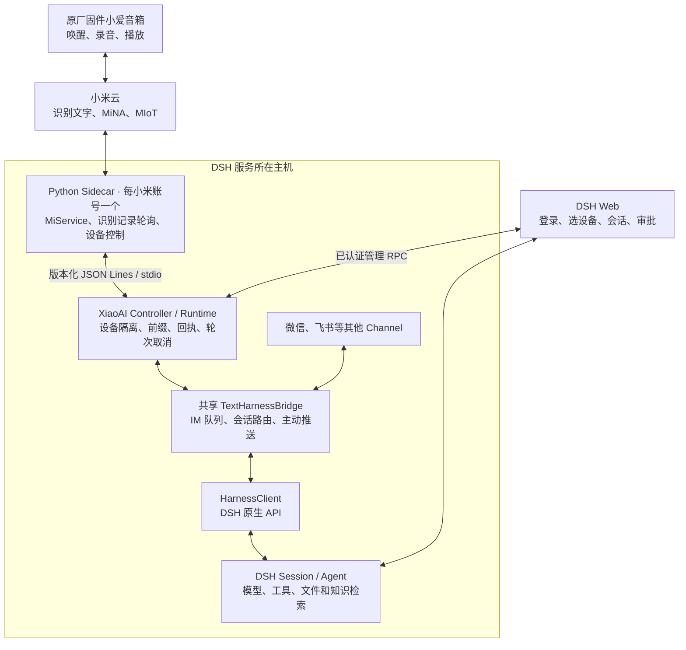
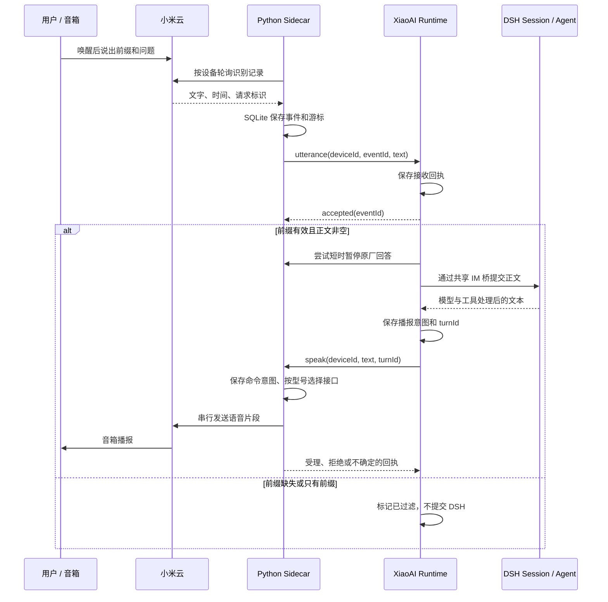

# 小爱音箱 XiaoAI Channel

XiaoAI Channel 将原厂固件小爱音箱接入 DSH-IM。用户在「设置 → IM机器人 → 小爱音箱」登录小米账号、选择音箱后，可以用带前缀的语音进入 DSH 原生会话，调用同一套模型、Agent、工具及检索能力，并由原音箱播报回复。

本实现基于上游 **DSH-IM 5.10.0** 集成。功能的部署验收来源为 `5.7.0+xiaoai.9`；该部署版本号只用于说明验收来源，上游正式发版号由维护者决定。

PR 合并并正式发版前，请从本功能分支或已审阅的固定提交构建。保留 `package.json` 的上游版本号不表示官方 npm 同版本已经包含 XiaoAI 功能。

## 修改内容

| 范围 | 实现 |
| --- | --- |
| 渠道入口 | 在现有 IM 设置中增加小爱音箱页面，复用 IM 表单、卡片和管理 RPC |
| 小米授权 | 页面内账号登录、短信/邮箱验证码、设备发现、授权失效提示 |
| 多音箱 | 一次登录勾选多个设备；一个账号共用一个长期 Python 进程，各音箱独立绑定会话、前缀、工作区和模型 |
| 对话处理 | 每次提问必须带配置的前缀，复用 `TextHarnessBridge` 和 DSH 原生 Session/Agent 接口 |
| 播报与取消 | 分段串行播报；按语音轮次取消排队片段和迟到回复；可单独停止播报，也可同时停止任务 |
| 型号适配 | 版本化能力表覆盖 19 个型号及 X4B/ASX4B 别名，按型号选择 TTS、暂停和播放状态接口 |
| 故障恢复 | 持久化识别游标、消息及命令回执；不确定的操作不盲目重放；网络失败退避，授权失败等待重新登录 |
| 诊断 | 显示连接状态、适配情况及最近播报的接口、HTTP/业务码，区分云端受理与实际发声 |

## 架构与职责



Python 负责小米授权、识别文字获取和音箱控制。模型调用、工具执行、知识检索和完整会话记录由 DSH 负责。Sidecar 不接收模型密钥，也不执行模型生成的 shell 指令。

小米云识别记录采用轮询方式获取。每台设备有独立轮询、游标、退避与播放锁；同一账号的单次 MiService 请求经过串行化处理，完整回答的播放等待不会锁住其他音箱。

## 一次对话如何处理



默认前缀为 **`让大肥鱼回答`**，可在设备卡片修改。它是识别文字的路由前缀；音箱仍需先按原厂方式唤醒并进入聆听。

| 语音示例 | 行为 |
| --- | --- |
| `让大肥鱼回答，解释一下这个概念` | 将正文提交该音箱绑定的 DSH 会话 |
| `让大肥鱼回答` | 忽略空正文，不等待下一句话 |
| 下一轮只说 `继续解释` | 没有前缀，不进入 DSH |
| `让大肥鱼回答，查看状态` | 复用 DSH 状态命令 |
| `让大肥鱼回答，新建会话` | 为后续对话创建新会话 |
| `让大肥鱼回答，停止播报` | 取消本轮剩余语音；任务结果仍可在 Web 查看 |
| `让大肥鱼回答，停止回答` | 请求停止任务，同时取消本轮语音 |

回答 DSH 的追问时也需带前缀。审批在 DSH Web 处理。每台音箱默认保持自己的多轮会话，也可在设备卡片选择当前工作区中已有的会话。

## 中断、原厂抢答与完成状态

取消操作使当前语音轮次失效，丢弃同轮次排队片段、正在等待的输出及随后到达的旧回复；取消状态同时写入回执。显式停止播报还会向对应设备发送暂停/停止命令，停止确认本身保持静默。

新取得的语音记录可以使旧轮次的后续播报失效；没有前缀的原厂问题不会因此进入 DSH。仅唤醒、按键等事件是否及时上传取决于设备固件，因此不能保证“只说唤醒词”就能立刻取消服务端整轮语音。

有效前缀问题会触发一个有超时的原厂回答暂停窗口，并在 DSH 开始播报前结束。短原厂回答可能在识别记录上传之前已经播放，故仍可能听到“我不知道”等抢答。该功能为尽力抑制，不保证原厂零发声。

长回答清理不适合朗读的代码块和链接后，按最多 120 字符分段串行发送。播放状态只用于观察和片段间等待；云端返回成功不代表用户确实听到声音，`completionConfirmed` 保持 `false`，不将估算时长当成完成证据。

## 型号适配

能力表位于 [`sidecar/device_profiles.json`](../sidecar/device_profiles.json)，适配代码位于 [`sidecar/speaker_adapter.py`](../sidecar/speaker_adapter.py)。表中保留各型号 MIoT 规范来源；下列指令的形式为 `[siid, aiid]`。

| 播报路径 | 型号 |
| --- | --- |
| MiNA `mibrain/text_to_speech`；记录 MIoT 等价指令 `[5,1]` | LX01 |
| MIoT `[5,1]` | LX06、S12、LX5A、LX05、L06A、LX04 |
| MIoT `[5,3]` | OH2、L05B、L05C、ASX4B / X4B |
| MIoT `[7,3]` | OH2P、L15A、X10A、L17A、X6A、X08E、X8F |
| MIoT `[3,1]` | L09A |

LX01 保留已验证的 MiNA 路径。其他已配置型号使用设备发现返回的真实 `miotDID` 调用 MIoT，不能用 MiNA 的 UUID 代替。暂停动作和播放状态数值同样按型号规范解释，运行时不联网下载规范。

未知型号、缺少型号信息或缺少 MIoT DID 时使用兼容 MiNA 路径，并显示未验证状态，不将未知设备标成 LX01。新增型号应先核对其 `play-text` 动作、输入属性、暂停动作及状态枚举，再补充能力表和实机验证。

MIoT 请求使用 MiService 当前登录流程的客户端标识；其旧米家客户端标识在验收环境返回 HTTP `429` / 业务码 `-127`，对照查询更换标识后返回 `200` / `0`。修改只作用于 MIoT API 请求，MiNA 路径保持原有请求头。

TTS 超时或结果不确定时不会自动切换另一接口再播一次。接口拒绝、授权失败和 HTTP 限流分别保留安全回执；限流期间遵循有界的 `Retry-After` 退避。MIoT 播报授权失败不会直接停掉仍可工作的 MiNA 识别链路。

## 构建和运行

### 运行条件

- Node.js 和 DSH 版本遵循根目录 `package.json` 的兼容声明；已有部署验收环境为 Node.js 24、DSH `0.2.1-rc.2`。
- Python 哈希锁按平台区分：`sidecar/requirements.lock` 用于 **Linux ARM64 / CPython 3.13**；`sidecar/requirements-windows.lock` 用于 **Windows x64 / CPython 3.11、3.13**。其他架构或 Python ABI 需准备匹配锁文件并验证，不能直接套用 Linux 锁。
- DSH 服务账户能够执行配置的 Python，读写自己的 DSH 数据目录，并通过 HTTPS 访问小米账号、MiNA 和 MIoT 服务。
- 小米账号绑定至少一台音箱。小米需要验证码时，在 Web 页面内完成。

当前 MIoT 使用默认中国区入口；其他地区的账号、设备和服务端区域选择尚未验证。

Python 子进程在 POSIX 默认使用 `/usr/bin/python3`，在 Windows 默认从服务进程的 PATH 查找 `python.exe`；默认依赖目录为已安装插件中的 `sidecar/vendor/`。推荐显式配置已验证的解释器绝对路径，避免桌面进程没有继承终端的 PATH，或命中 Windows 的应用执行别名。受信任的 Host 配置可在 `xiaoai` 配置下覆盖 `python`、`dependencyDir`、`sidecarScript`；设备管理页面不能设置可执行路径。

Windows 上，Node 创建的 stdin 管道不支持 Python Proactor 要求的重叠 I/O；Sidecar 因此在线程中读取相同的有界 JSONL 帧，POSIX 保留 asyncio 管道。切换到 Windows Selector loop 不能解决此问题。

### 从功能分支构建

以下为 POSIX shell 示例。将工作根目录替换为环境允许的位置；复用已有兼容运行时和依赖。示例不会安装或升级系统 Python，也不会修改 DSH 的模型登录。

```sh
export XIAOAI_WORK_ROOT=/absolute/path/to/approved-development-root
export TMPDIR="$XIAOAI_WORK_ROOT/tmp"
export PIP_CACHE_DIR="$XIAOAI_WORK_ROOT/cache/pip"
export npm_config_cache="$XIAOAI_WORK_ROOT/cache/npm"
mkdir -p "$TMPDIR" "$PIP_CACHE_DIR" "$npm_config_cache" "$XIAOAI_WORK_ROOT/source"

git clone --branch feat/xiaoai-speaker-channel \
  https://github.com/xrggen/dsh-im.git "$XIAOAI_WORK_ROOT/source/dsh-im"
cd "$XIAOAI_WORK_ROOT/source/dsh-im"

npm ci
NODE_ENV=production npm run build

# 仅适用于上述 Linux ARM64 / CPython 3.13 构建环境。
# python3 需已有 pip，并与运行服务使用的 Python ABI 一致。
python3 -m pip install --require-hashes --only-binary=:all: \
  --target "$PWD/sidecar/vendor" -r sidecar/requirements.lock

# 安装的是含构建包和 Python 依赖的本地目录。
dsh plugin --profile web add --save-exact "$PWD"
```

`sidecar/vendor/` 是打包输入，受 Git 忽略；从 Git 拉取源码并不包含这些依赖，也不会在登录时自动安装依赖。必须先准备依赖，再让 DSH 加载完整插件。维护者发布包时需同时包含 Sidecar、能力表、匹配的 Python 依赖和各依赖许可证。

按现有部署方式重启 `dsh web`，强制刷新浏览器后打开「设置 → IM机器人 → 小爱音箱」。本功能不新增独立常驻 daemon、Docker 服务或 CPU、内存、PID、IO 限额。

### Windows 构建与安装（PowerShell）

以下示例使用已有的 Windows x64 CPython 3.11 或 3.13。把工作根目录换成环境允许的位置；已存在兼容的解释器、虚拟环境、源码和缓存时直接复用，不重复安装。Windows 依赖可放在外部虚拟环境，不需要把它们复制到 Git 源码。

```powershell
$XiaoaiRoot = 'C:\approved\xiaoai'
$env:TEMP = Join-Path $XiaoaiRoot 'tmp'
$env:TMP = $env:TEMP
$env:TMPDIR = $env:TEMP
$env:PIP_CACHE_DIR = Join-Path $XiaoaiRoot 'cache\pip'
$env:npm_config_cache = Join-Path $XiaoaiRoot 'cache\npm'
New-Item -ItemType Directory -Force -Path $env:TEMP, $env:PIP_CACHE_DIR, $env:npm_config_cache | Out-Null

git clone --branch feat/xiaoai-speaker-channel https://github.com/xrggen/dsh-im.git (Join-Path $XiaoaiRoot 'source')
Set-Location (Join-Path $XiaoaiRoot 'source')
npm ci
npm run build

# python 必须是已有的受支持版本；复用环境时跳过 venv 创建。
python -m venv (Join-Path $XiaoaiRoot 'python')
$XiaoaiPython = Join-Path $XiaoaiRoot 'python\Scripts\python.exe'
& $XiaoaiPython -m pip install --cache-dir $env:PIP_CACHE_DIR --require-hashes --only-binary=:all: -r sidecar/requirements-windows.lock
& $XiaoaiPython -c "import sys, aiohttp, miservice; print(sys.version); print(aiohttp.__version__)"

$env:XIAOAI_TEST_PYTHON = $XiaoaiPython
node --test test/xiaoai/*.test.mjs
& $XiaoaiPython -B test/xiaoai/sidecar_test.py
node scripts/verify-package.mjs
```

将如下字段合并到 DSH-IM 插件的受信任 Host 配置中，保留已有渠道设置；路径对应上面实际使用的虚拟环境。`python` 是解释器文件，`dependencyDir` 是包目录，两者不能互换，也不能在小米账号或密码栏中填写。

```yaml
xiaoai:
  python: C:/approved/xiaoai/python/Scripts/python.exe
  dependencyDir: C:/approved/xiaoai/python/Lib/site-packages
```

然后使用现有 DSH CLI 入口安装构建目录：`dsh plugin --profile web add --save-exact (Get-Location).Path`，按现有方式重启所用 Web/桌面 Host 并刷新页面。安装入口和配置作用域需与正在使用的 DSH profile 对应。外部虚拟环境是持续运行依赖，不能在验收后作为临时文件删除。

上述检查只使用模拟小米云数据验证真实 Windows 子进程通信，不登录真实账号或使音箱发声。实际账号在下述页面流程中登录；以设备卡片的测试播报确认声音。

### 页面接入与日常运行

1. 点击「小米账号接入」，输入音箱所属账号和密码。
2. 如页面要求短信或邮箱验证码，使用本次登录新收到的验证码完成验证。
3. 勾选要接入的音箱并设置前缀，点击接入。部分失败时页面会保留逐设备结果，便于重试未完成的设备。
4. 在设备卡片点击「测试播报」，确认实际发声。页面的“已连接”表示云端链路正常，不能替代发声检查。
5. 按原厂方式唤醒音箱，进入聆听后说“让大肥鱼回答，连接测试”。在 Web 中可查看同一会话的完整回复和工具结果。

每台音箱可独立修改前缀、工作区、模型、Agent 预设和会话绑定。主动推送只允许发送给已绑定的目标设备。重新绑定和删除设备不会替用户清理 DSH 的完整会话历史。

此渠道的发送者身份是音箱设备 ID；访问设置中的白名单也按设备匹配，不识别实际说话人或家庭成员声纹。

页面和 Host 运行提示沿用 DSH-IM 的界面语言机制；配置的语音前缀和语音控制词保持原文，不随界面语言切换。受控错误可按语言显示，原始小米异常仍需经过遮蔽后才能进入页面。

## 状态、凭证与恢复

默认数据目录为 `$DSH_HOME/integrations/dsh-xiaoai/`；未设置 `DSH_HOME` 时遵循 DSH 默认用户目录。

| 相对路径 / 存储 | 用途 |
| --- | --- |
| `config.json`、`workspaces.json` | 机器人配置、工作区及相关设置 |
| DSH credentials provider | 每台设备的小米账号引用、身份和前缀等凭据数据 |
| `bots/accounts/<accountId>/mi-token.json` | 同账号共用的有效授权状态，私有文件权限 |
| `bots/accounts/<accountId>/transport.sqlite3` | 每设备游标、待确认事件、命令及取消记录 |
| `bots/<botId>/state.json` | 设备与原生 DSH 会话的映射 |
| `bots/<botId>/receipts.json` | Node 侧入站处理和出站播报回执 |
| `bots/auth/<authId>/` | 短时登录进程的数据；结束、超时或 Host 恢复时清理 |

密码和验证码只用于当前交互登录，不写入设备凭据。后续由 `passToken` 续期；授权失效后要求重新登录，不反复尝试存储的账号密码。Sidecar 的 stdin 传递认证信息，进程参数中不放密码或令牌；子进程环境不继承 Host 的模型密钥。

Sidecar 先保存云端事件再发送给 Node，Node 先保存接收回执再确认，提交状态和播报命令也分别持久化。崩溃时无法判断是否已经执行的工作标记为不确定，不自动再次提交或播报；设备卡片提供核对入口。这一策略优先避免重复操作，不宣称严格的端到端 exactly-once。

完成回执通常保留七天并按方向设置常规条数上限；活跃、待处理和不确定记录受保护，不因超过常规上限而被静默丢弃。重启时超过五分钟的旧语音被过滤；长时间离线时受小米云历史窗口限制，不能保证补回全部语音。

## 测试与验收范围

在源码根目录执行，测试临时目录使用前述 `TMPDIR`：

```sh
node --test test/xiaoai/*.test.mjs
PYTHONPATH="$PWD/sidecar/vendor" python3 -B test/xiaoai/sidecar_test.py
```

Node 测试覆盖页面验证状态、多设备路由、前缀过滤、原生会话绑定、回执恢复、主动推送幂等、取消与迟到回复隔离。POSIX 真实子进程默认使用 `/usr/bin/python3`；Windows 必须设置 `XIAOAI_TEST_PYTHON` 后运行，未设置会跳过相关用例。该路径应指向已安装匹配依赖的 Python，不是目录或 `py -3.13` 命令字符串。Windows CI 对 CPython 3.11、3.13 安装对应哈希锁并显式设置此变量，检查 ready、中文收发、TTS 幂等、多设备、UTF-8 分片、错误退出、有界帧、EOF 及无孤儿进程的清理。

Python 测试覆盖鉴权流程回放、网络/授权分类、型号指令、MiNA/MIoT 设备标识、限流、401 续期、回执及分段中断。安装依赖后应为 25 项全部通过，鉴权回放不应因缺少 MiService/aiohttp 被跳过。模拟提供者只有显式测试开关才可启用，管理 RPC 不提供开启入口。

部署验收来源版本的结果为 ARM64 Python **25 项通过**、ARM64 Node **25 项通过**、React 页面 **5 项通过**；三台实机（两台 OH2、一台 LX01）均由用户确认测试播报实际发声。已有音箱会话绑定和微信连接在更新后保留。移植到 5.10.0 分支后的构建与回归结果以 PR 中记录为准。

19 个型号表示已核对并配置指令，并不表示全部做过实机测试。型号固件差异、仅唤醒中断、原厂回答抑制以及播放完成检测仍需逐设备验收。

## 诊断与限制

| 现象 | 优先检查 |
| --- | --- |
| 能进入 DSH，但音箱无声 | 点击测试播报；查看出站回执、实际型号、MIoT DID、授权和返回码；确认音量 |
| `429` / `-127` | 核对是否加载了当前 MIoT 客户端标识适配，遵循服务端退避；不要连续重放 TTS |
| 云端已受理但没有声音 | 受理回执不是实际播放证明；继续核对固件、设备路径和音量 |
| 前缀问题未进入 DSH | 查看小米实际识别文字是否以所配置前缀开头，且有非空正文 |
| 先听到原厂短回答 | 识别记录的上传/轮询存在延迟，原厂暂停窗口只能尽力抑制 |
| 重启后提示需核对 | 先查原会话和音箱是否已经执行，再决定是否重发，避免重复操作 |
| 登录验证码失败 | 结束本次登录，重新发起并使用新验证码；不复用旧验证码 |
| Windows 无法启动 Python / `sidecar-spawn-failed` | 核对 Host 使用的 `xiaoai.python` 绝对路径及服务账户权限，不要重新输入小米密码 |
| Windows 停在连接中、出现 `WinError 6` | 确认使用含线程 stdin 修复的 Sidecar，按 Windows 步骤运行真实子进程测试；不要切换 Selector loop |
| 缺少 `miservice` / `aiohttp` 或 `configure-unavailable` | 用配置的同一解释器检查依赖导入，核对 `dependencyDir` 及平台哈希锁 |

浏览器和日志只展示经过约束的状态、步骤、数值错误码和异常类型，不输出原始鉴权响应、密码、验证码、Cookie、令牌或带敏感查询参数的 URL。排查时也不要将运行目录或登录文件提交到 Git。

## 参考与许可证

- [MiService](https://github.com/Yonsm/MiService)：小米账号、MiNA / MIoT 接口依赖，MIT。
- [XiaoGPT](https://github.com/yihong0618/xiaogpt)：对话记录请求和授权恢复流程参考，MIT。
- [MiGPT 型号表](https://github.com/idootop/mi-gpt/blob/main/docs/compatibility.md)：型号指令参考，MIT；实际规范链接保留在能力表中。
- [小米 MIoT 规范服务](https://miot-spec.org/miot-spec-v2/instances?status=all)：动作、属性和数值定义。
- [第三方声明](../THIRD_PARTY_NOTICES.md)：Python 依赖和参考来源的归属信息。
