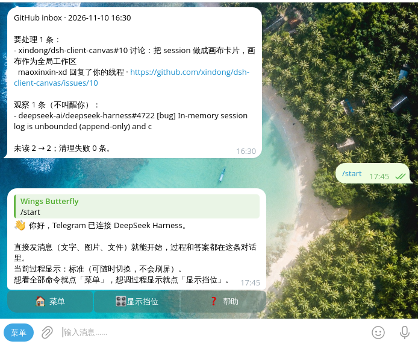
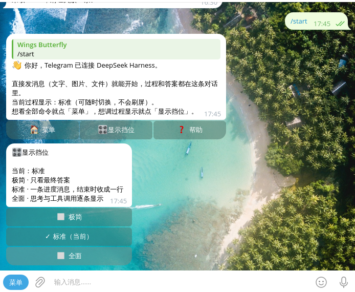
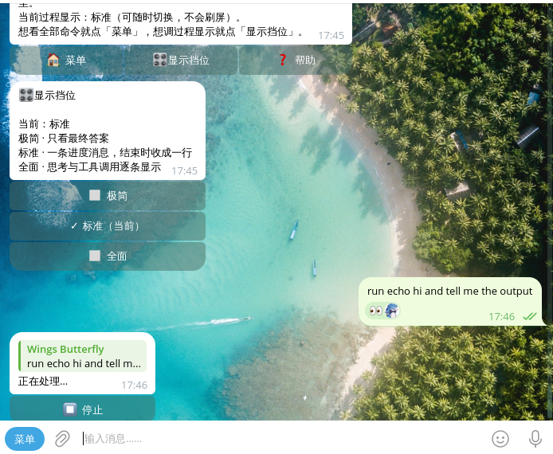
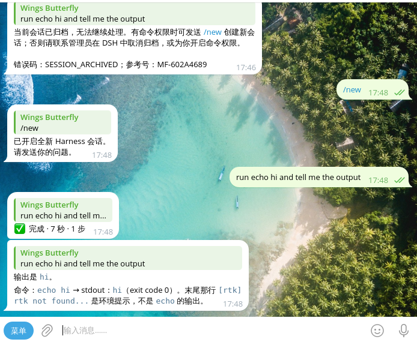
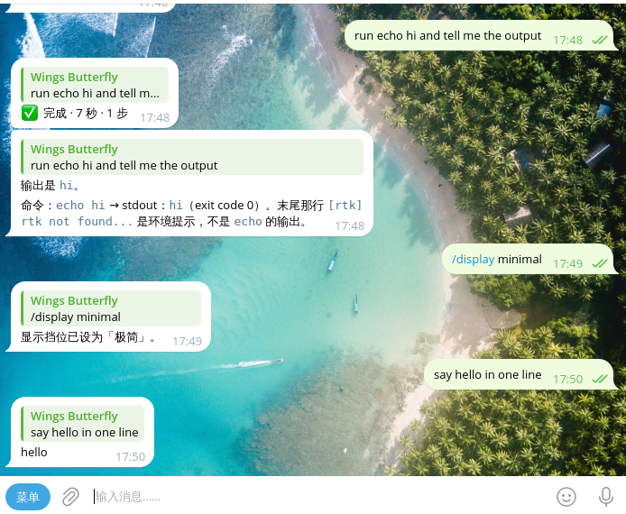
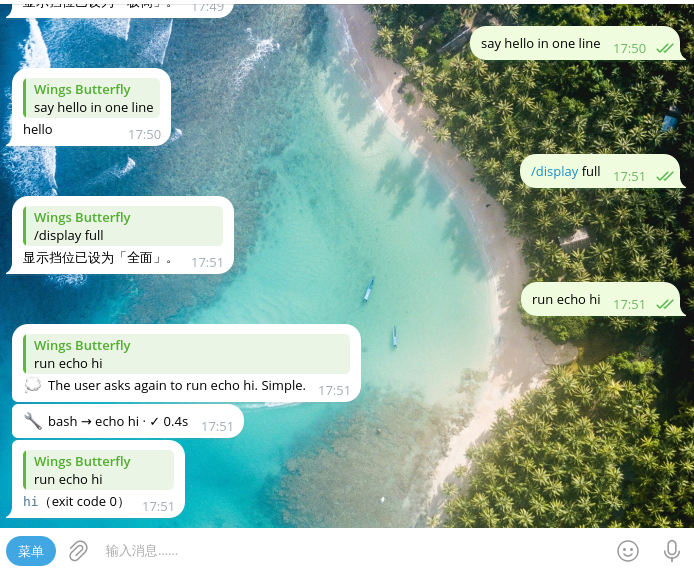

# Telegram 交互改版：验收报告（对照需求逐条）

> 版本 `5.10.1-wings.2`｜截至 2026-11-10 18:20｜结论：**需求全部落地并验收通过**——真 Telegram Desktop 截图（`kwin-mcp` 虚拟会话，未解锁主桌面）+ 5107 例测试 + 6 例宿主矩阵 + 三轮独立评审问题清零。

## 一、需求对照表

| # | 需求（用户原话） | 做到了什么 | 证据 | 状态 |
| --- | --- | --- | --- | --- |
| 1 | 「工具调用和思考过程展示不要大量消息刷屏」 | 默认挡位改为**标准**：一轮只占一条消息，原地改写；出厂不再逐行发消息（改版前缺省＝逐条、无节流） | `presentation-levels.test.mjs` L1–L2、L12；宿主实测 `api-calls.jsonl` 每条序列 | ✅ |
| 2 | 「极简、标准、全面 3 挡位设置」 | `/display` 卡片 + `/display 极简\|标准\|全面` + DSH 设置页下拉；`thinkingTraces` 变成挡位别名，切换不重连 | L7/L11/L15–L17、`presentation-level.test.mjs`；宿主实测卡片往返与落盘 | ✅ |
| 3 | 「方便用户查看 dsh 的各种情况、工具调用情况」 | `/status` 卡片：连接/工作区/会话/模型/预设/**当前挡位**；全面挡位每个工具行收尾补 `· ✓ 0.8s` / `· ⚠️ 失败 0.8s`；标准挡位进度行带「秒数 · 步数 · 最近工具」 | L18、`status-card.test.mjs`、`presentation-levels-runtime.test.mjs`（10 例）；宿主实测状态卡含 `Display: Standard` | ✅ |
| 4 | 「允许合并命令，或者新增 /命令」 | 新增 `/display`；`/menu` 进原生菜单首项；`/start` 欢迎卡；`/ws` 等别名退居输入法（菜单只留主名）；`/status` 与 `/display` 互相跳转 | `command-menu.test.mjs`、`command-help`、`welcome-card.test.mjs` | ✅ |
| 5 | 「简洁优雅美观」 | 极简只有占位＋答案；标准两行＋一行回执；全面逐条带 ✓/耗时；回执清键盘；⏹ 停止按钮只在本回合有效、结束即消失 | 6 例宿主矩阵（`check-matrix.sh`）、L23/L24 | ✅（视觉细节待真机） |
| 6 | 「用测试 bot 优化」 | 隔离 `DSH_HOME` + 假 Bot API（CONNECT 代理 + 自签 CA）+ 假 LLM，跑真 `dsh web` 与真插件包；`/display`、`/status`、`/start`、`⏹`、三挡位回合、失败工具、群命令全部在宿主级验过 | `investigation/`、`docs/方案/…记录.md` §6、技能 `dsh-plugin-development/references/host-e2e-harness.md` | ✅ |
| 7 | 「computer use 控制 gpd 上的 TG 客户端查看真实渲染」 | **完成**：用 `kwin-mcp` 起独立 `dbus-run-session` + `kwin_wayland --virtual` 虚拟会话，在里面跑**真的 Telegram Desktop（flatpak）**，libei 注入键盘/鼠标、KWin ScreenShot2 截图；gpd 主会话全程锁屏未被触碰 | 截图见下节；`kwin-mcp v0.12.0`，输入后端 KWin EIS | ✅ |

### 真机截图（Telegram Desktop 1280×800 虚拟会话）

| 截图 | 对应需求 |
| --- | --- |
|  | `/start` 欢迎卡 + 三个入口（菜单 / 显示挡位 / 帮助） |
|  | `/display` 三挡位卡片，当前挡位带 ✓ |
|  | 标准挡位：占位「正在处理…」+ `⏹ 停止` |
|  | 标准挡位收尾：`✅ 完成 · 7 秒 · 1 步` + 答案（按钮已消失） |
|  | 极简：只有答案，没有过程消息 |
|  | 全面：💭 思考行、`🔧 bash → echo hi · ✓ 0.4s`、答案逐条 |

### 怎么复现这套视觉验证（不需要解锁桌面）

```bash
# gpd 上（一次性，用户级安装，可 uv tool uninstall 回滚）
uv tool install kwin-mcp

# 起一个隔离会话（tmux 里常驻，便于连续发命令）
tmux new -d -s kwinmcp "kwin-mcp-cli"
tmux send-keys -t kwinmcp "session_start screen_width=1280 screen_height=800" Enter
tmux send-keys -t kwinmcp 'launch_app command="flatpak run org.telegram.desktop tg://resolve?domain=<bot>"' Enter
tmux send-keys -t kwinmcp "screenshot region=[460,150,694,570]" Enter   # 只截聊天区
tmux send-keys -t kwinmcp "mouse_click x=680 y=700" Enter               # 点输入框
tmux send-keys -t kwinmcp 'keyboard_type text="/start"' Enter
tmux send-keys -t kwinmcp "keyboard_key key=Return screenshot_after_ms=[1500,6000]" Enter
tmux send-keys -t kwinmcp "session_stop" Enter
```

坑：`launch_app command=...` 带空格必须整段加引号（否则 CLI 把它当 `key=value` 解析报错）。

## 二、跑了多少、绿了没有

| 层 | 数量 | 结果 |
| --- | --- | --- |
| 单元 + 集成（`npm test`） | 5107 | 5106 通过、0 失败、1 跳过（缺 ffmpeg 的环境用例） |
| 宿主级矩阵（`check-matrix.sh`） | 6 个场景 | 6/6 PASS（2026-11-10 18:20 复跑仍全绿） |
| 真客户端截图 | 6 张 | 见上节（`kwin-mcp` 虚拟会话） |
| 独立评审 | 3 轮 | 第 1 轮：1 阻塞 + 5 应修；第 2 轮：5 应修；第 3 轮：5 应修（含 1 个坏按钮）——**全部已修** |
| 打包 | `npm pack` + `verify-package` | 通过；sha256 `53a886d5…` |

## 三、部署状态

| 设备 | 版本 | 说明 |
| --- | --- | --- |
| wings-gpd | `5.10.1-wings.2`（`53a886d5`） | 已重启，`wings_gpd_dsh_bot` connected、`presentationLevel=standard`；用户可直接体验 |
| wings-tx-us1（本会话所在） | `5.10.1-wings.1` | 重启会结束当前会话，等用户点头 |
| wings-pc-win | `5.10.1-wings.1` | 设备离线，等用户点头 |

## 四、还差什么

1. **另外两台升级**：一句「推」即可；tx-us1 升级会顺带结束本会话。
2. 可选打磨（未列为需求）：全面挡位没有 ⏹（无占位消息可挂）；`/usage` 类用量查看依赖别的插件，暂不做。

> 附：这次视觉验证顺带证明了「锁屏也能做真机验收」——`kwin-mcp` 的虚拟会话与用户会话完全隔离，不需要解锁、不需要 portal 授权弹窗。

## 五、回滚

各设备 `~/.dsh/profiles/web` 把依赖改回 `file:...5.10.1-wings.1.tgz` → `rm -rf node_modules/@xmanrui` → `dsh plugin --profile web install` → 重启 dsh-web。备份为同目录 `package.json.bak-*`。
